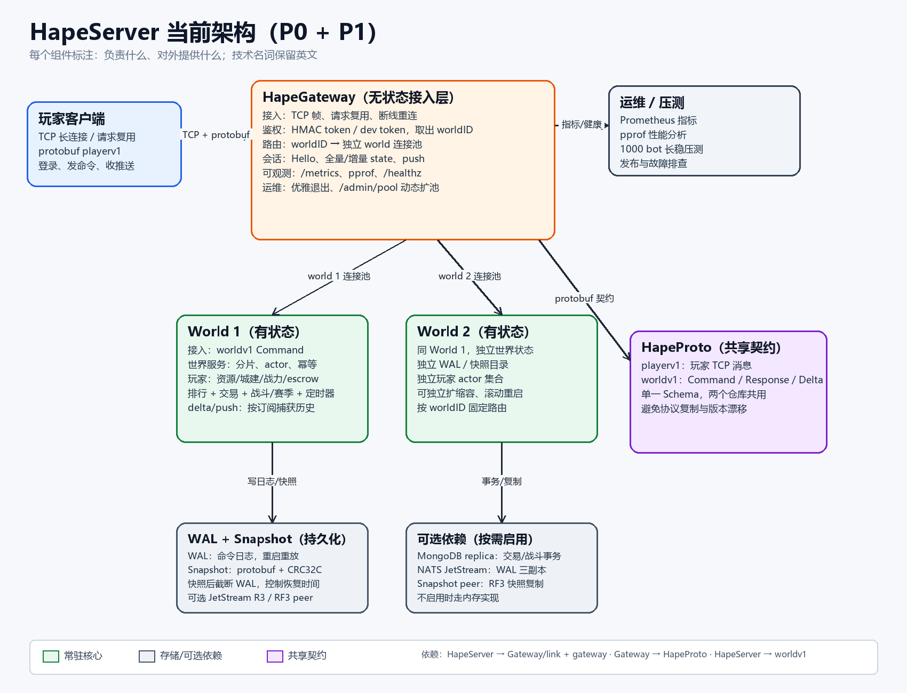
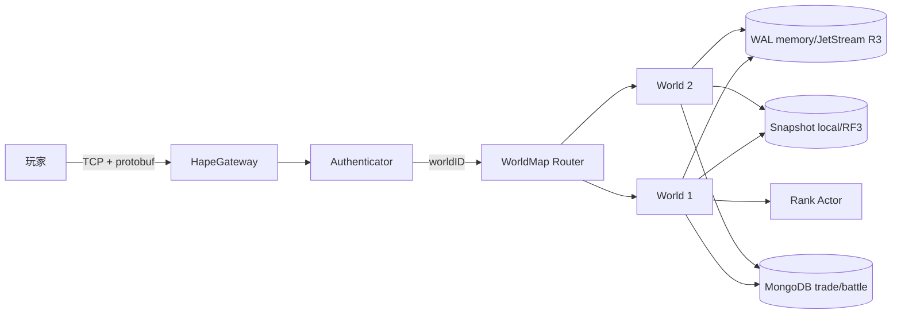
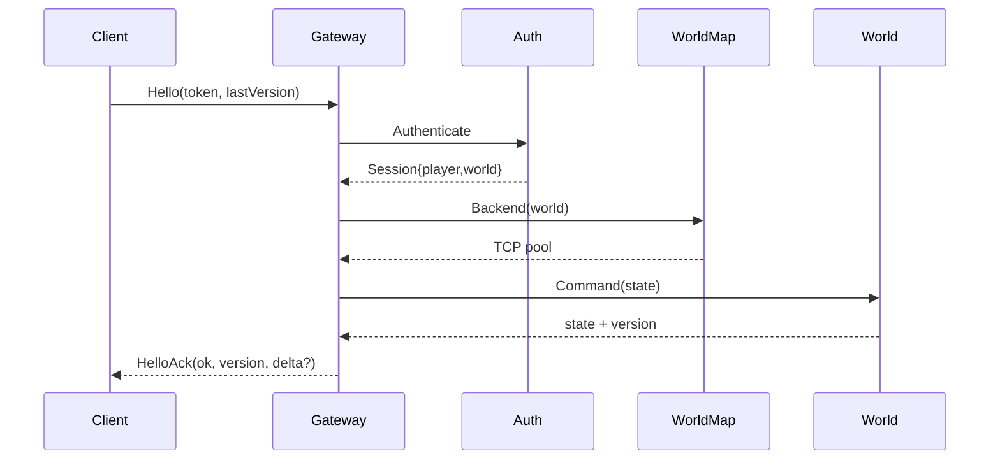
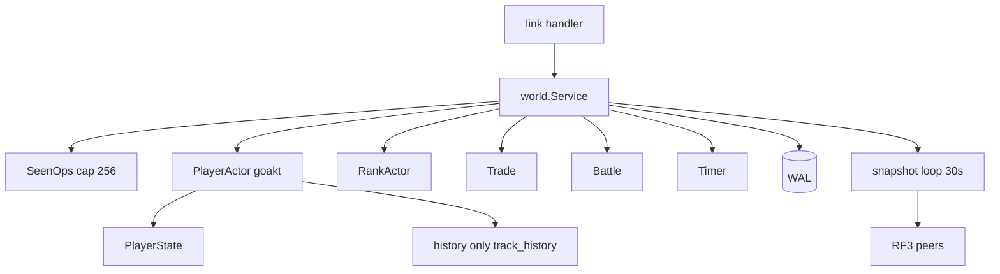

# HapeServer 当前实现架构



> 更新时间：2026-11-01  
> 范围：已实现并验证的 P0/P1 结构；设计稿见 [slg-server-architecture.md](slg-server-architecture.md)。

## 1. 三仓库

| 仓库 | 模块 | 职责 |
|---|---|---|
| HapeServer | hapeserver | world、actor 分片、WAL/快照、排行、交易/战斗、bot |
| HapeGateway | github.com/CoderYkj/HapeGateway | TCP 接入、鉴权、多 world 路由、指标、优雅退出 |
| HapeProto | github.com/CoderYkj/HapeProto | playerv1 / worldv1 protobuf |

版本：HapeGateway v0.2.0、HapeProto v0.1.0、HapeServer 依赖 Gateway v0.2.0。

## 1.1 组件功能标注

| 组件 | 主要功能 | 具体做什么 |
|---|---|---|
| 玩家客户端 | TCP 长连接、发命令、收推送 | 用 `playerv1` 完成 Hello/请求/事件；断线后带 `lastStateVersion` 重连 |
| HapeGateway | 无状态接入层 | TCP 帧解析、请求复用、鉴权、按 worldID 选 world 连接池、Hello/断线重连、delta/push、指标、优雅退出 |
| World 1 / World 2 | 有状态世界进程 | 每个 world 独立 actor 分片、玩家状态、资源/城建/战力、排行、交易、战斗/赛季、定时器、WAL/快照 |
| WAL + Snapshot | 持久化与恢复 | WAL 记录命令用于重放；Snapshot 存 protobuf 状态并截断 WAL；可选 JetStream R3 / RF3 peer |
| 可选依赖 | 按需增强 | MongoDB replica 承担交易/战斗事务；NATS JetStream 做 WAL 三副本；Snapshot peer 做 RF3 快照复制 |
| HapeProto | 共享契约 | `playerv1` 定义玩家 TCP 消息，`worldv1` 定义 Command/Response/StateDelta；两个仓库共用一份 Schema |
| 运维 / 压测 | 运行保障 | Prometheus 指标、pprof 性能分析、1000 bot 长稳压测、故障排查 |

## 2. 系统上下文



```text
Players -> HapeGateway
              | auth: HMAC/dev token
              | router: worldID -> backend pool
       +------+------+
       |             |
    World 1       World 2
    actors        actors
    WAL/snapshot  WAL/snapshot
       +------+------+
          optional:
          NATS JetStream R3
          MongoDB replica set
          snapshot peer RF3
```

## 3. 模块依赖

```text
HapeServer
  cmd/world, cmd/bot
  internal/world -> runtime/goakt, storage/wal, storage/snapshot, rank, trade, battle, timer
  internal/world -> HapeProto/worldv1
  cmd/bot -> HapeGateway/link, HapeGateway/gateway

HapeGateway
  link -> HapeProto/playerv1
  gateway -> HapeProto/playerv1 + worldv1
  cmd/gateway, cmd/token

HapeProto
  playerv1, worldv1 (无业务依赖)
```

## 4. 连接与路由



Token：`v1:<world>:<player>:<expUnix>:<base64url(hmac-sha256)>`。  
`-auth-secret` 启用 HMAC；为空走 `dev:<world>:<player>`。  
`-world-map "1=host:19100,2=host:19102"` 静态路由；`-world-tcp` 是 fallback。  
`/admin/pool?world=2&size=8` 调整单 world 池。

## 5. World 内部



- 单玩家单 actor，串行写。
- SeenOps 幂等 cap 256；Settled cap 1024。
- 只有 `track_history` 会话捕获历史；其他 delta 回退全量。
- 快照 protobuf + CRC32C，`EncodeTo` 流式写。
- WAL 可选 JetStream R3；快照可选 RF3 peer；交易/战斗可选 Mongo。

## 6. 数据与恢复

```text
Command -> World.Service -> WAL append -> Actor apply
        -> snapshot every N seconds -> WAL truncation
Recovery: latest snapshot -> replay WAL tail -> rebuild actors/rank -> listen
```

| 数据 | 默认 | 可选 |
|---|---|---|
| WAL | 内存 | JetStream R3 |
| Snapshot | 本地 | RF3 peer |
| 交易/战斗 | 内存 | MongoDB replica |
| 排行 | RankActor 内存 | — |

## 7. 部署

```text
单 world:
bot -> gateway :9001 -> world :9000
                       admin :8081 (/metrics /healthz /admin/pool)
       world admin :8080 (/api/command /healthz)

多 world:
          LB
           |
      Gateway x N (无状态)
           | static world-map
      +----+----+
   World 1   World 2
```

## 8. 当前基线

- actor runtime goakt v4.6.4，world shards 12，gateway pool 4/world。
- GC `gcPercent=200`、`memoryLimitMB=512`，snapshot 30s。
- 1000 bot / 70m：839,001 请求、0 错误、p50 600µs、p99 36ms。
- world RSS 185→240MB，40 分钟后 236–241MB；gateway/bot ~150MB。

## 9. 已实现 / 未实现

已实现：TCP+protobuf、HMAC token、多 world 路由、actor 分片、幂等、delta/push、WAL/快照/RF3、rank、trade/escrow、battle/season、Mongo 事务、Prometheus、优雅退出、pprof、70m 压测。

未实现：账号注册/登录与 Mongo accounts、token 刷新/吊销、账号选区/迁移、gateway 服务发现、跨 world 排行/匹配、p99 长尾最终定位。