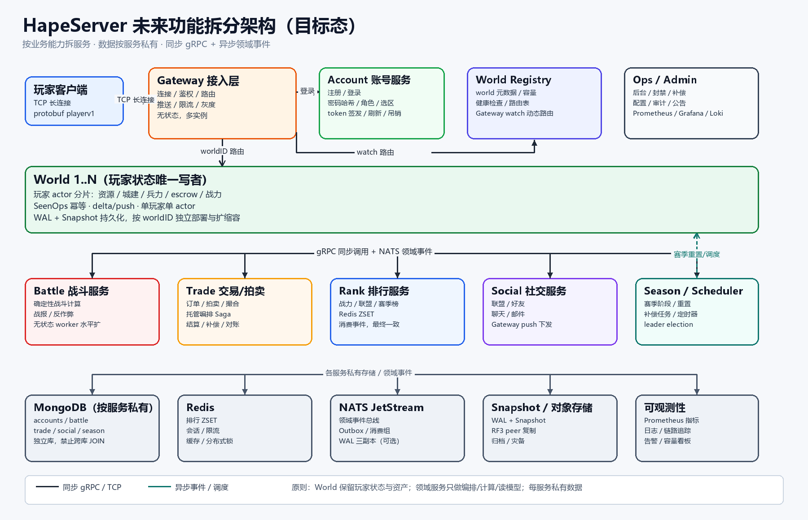
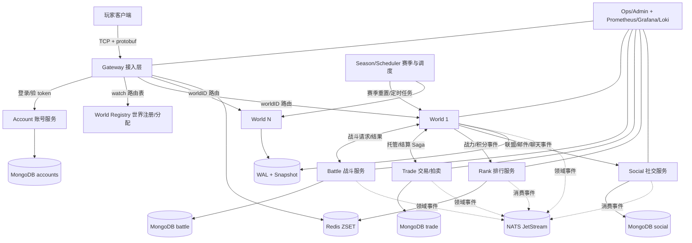
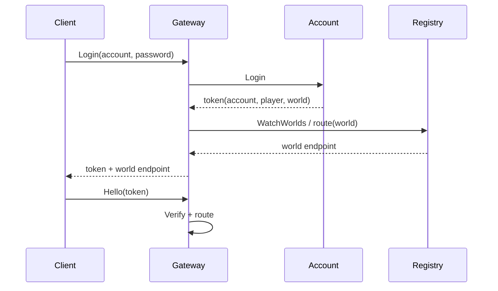

# HapeServer 未来功能拆分架构与实现目标



> 更新时间：2026-11-02  
> 定位：目标态架构（2–4 个季度），不是当前已实现结构。当前实现见 [architecture-current.md](architecture-current.md)。

## 1. 拆分原则

1. **按业务能力拆，不按技术层拆**：账号、世界、战斗、交易、排行、社交、赛季各自独立。
2. **World 仍是玩家状态的唯一写者**：资源、城建、兵力、escrow 不离开 world actor。
3. **同步短链路 + 异步最终一致**：在线命令走 gRPC；跨服务副作用走领域事件 + Outbox + Saga。
4. **数据按服务私有**：每个服务独立库/集合，禁止跨库 JOIN；只通过 API/事件交换。
5. **无状态服务水平扩，有状态 world 按 worldID 分片**。
6. **先解决上线阻断项，再拆非核心服务**：账号、世界注册/发现优先；排行/社交/交易按负载拆。

## 2. 目标架构



分层：

```text
接入层       Gateway（无状态，多实例）
账号/控制面  Account · World Registry · Season/Scheduler · Ops
世界层       World 1..N（有状态 actor 分片）
领域服务     Battle · Trade · Rank · Social
数据层       各服务私有 MongoDB / Redis / NATS / Snapshot / 对象存储
```

## 3. 服务职责

| 服务 | 主要职责 | 私有数据 | 同步接口 | 异步事件 | 扩展方式 |
|---|---|---|---|---|---|
| Gateway | 连接、鉴权、路由、推送、限流 | 无（Redis 连接态可选） | 玩家 TCP/protobuf | — | 无状态水平扩 |
| Account | 注册/登录、密码哈希、角色、选区、token 签发/刷新/吊销 | MongoDB accounts | gRPC Login/Refresh/Verify | account.created | 水平扩 |
| World Registry | world 元数据、容量、负载、路由表、分配 | etcd/Consul/K8s CRD | gRPC WatchWorlds | world.ready/draining | 控制面 HA |
| World | 玩家状态、资源、城建、兵力、escrow、delta/push | WAL + Snapshot | worldv1 Command | player.changed / battle.request | 按 worldID 分片 |
| Battle | 确定性战斗计算、战报、反作弊 | MongoDB battle | gRPC Resolve | battle.resolved | 无状态 worker |
| Trade | 订单、拍卖、托管编排、结算 Saga | MongoDB trade | gRPC Create/Settle | trade.locked/settled | 按 tradeID 分片 |
| Rank | 战力/联盟/赛季榜、分页查询 | Redis ZSET + 快照 | gRPC Top/Rank | 消费 player.changed | Redis 集群 |
| Social | 联盟、聊天、邮件、好友 | MongoDB social + Redis pub/sub | gRPC Alliance/Mail | chat/mail events | 按 allianceID 分片 |
| Season/Scheduler | 赛季生命周期、重置、补偿、定时任务 | MongoDB season | gRPC SeasonInfo | season.phase.changed | 单 leader + 租约 |
| Ops/Admin | 封禁、补偿、公告、配置、审计 | MongoDB admin | HTTP/gRPC | audit events | 独立部署 |

## 4. 关键流程

### 4.1 登录与选区



目标：登录 p99 < 200ms；token 支持刷新/吊销；账号可选区，world 满时进入排队/推荐。

### 4.2 在线命令

```text
Client -> Gateway -> World.Command
World: SeenOps 幂等 -> PlayerActor -> WAL -> Snapshot
World -> Gateway: state/version/delta
Gateway -> Client: response/push
```

World 内仍保持“单玩家单 actor + 单写者”，不因拆服务引入跨服务分布式事务。

### 4.3 交易 Saga

```text
Trade.Create
  -> World.LockEscrow (A/B)
  -> Trade.Match
  -> World.Settle (A/B)
  -> Trade.Completed
失败: World.Refund / Trade.Cancel
```

一致性：本地事务 + Outbox；补偿幂等；托管资产始终在 World 内。

### 4.4 排行

```text
World -> NATS player.changed
Rank consumer -> Redis ZSET
Rank -> 定期快照/对账
```

允许最终一致，目标延迟 < 2s；榜单查询不阻塞 world。

## 5. 数据与一致性

- **每服务私有库**：accounts / battle / trade / social / season 独立集合或实例。
- **Outbox**：业务写与事件写同库事务，relay 投递 NATS。
- **Saga**：交易、跨 world 迁移、赛季结算使用显式补偿。
- **幂等**：所有事件带 event_id；消费者去重表/Redis SET。
- **RPO/RTO**：已提交 WAL RPO=0；单 world 故障 RTO < 5 分钟；跨区域灾备 RTO < 30 分钟。

## 6. 部署

```text
Kubernetes / 自建容器平台
  ├─ gateway Deployment (HPA，按连接数/CPU)
  ├─ account Deployment
  ├─ registry StatefulSet/etcd 或 K8s Service + CRD
  ├─ world StatefulSet（每个 world 固定 PVC）
  ├─ battle/trade/rank/social Deployment
  ├─ season/scheduler Deployment（leader election）
  └─ NATS / MongoDB / Redis 独立集群
```

- Gateway 通过 Registry watch 路由，不再写死 `-world-map`。
- World 滚动发布：先 draining，再迁移/重连；客户端带 `lastStateVersion` 做 delta 恢复。
- 每个服务独立 CI/CD、独立回滚。

## 7. 实现目标与阶段

### Phase 1：账号 + 世界注册/动态路由（最高优先）

目标：

- Account：注册、登录、Argon2id 密码哈希、token 签发/刷新/吊销。
- World Registry：world 列表、容量、健康、路由 watch。
- Gateway：动态路由替代静态 `-world-map`；按 world 限流。
- 迁移：现有 HMAC token 升级为 account 签发。

验收：

- 登录 p99 < 200ms；token 校验 p99 < 20ms。
- Gateway 在 world 下线 30s 内摘除路由。
- 账号/角色/world 绑定正确；token 吊销立即生效。
- 账号服务不可用时，已登录玩家在线命令不受影响。

### Phase 2：排行 + 社交/邮件 + 赛季调度

目标：

- Rank 独立消费事件，支持全服/联盟/赛季榜。
- Social：联盟、邮件、聊天；聊天走 Gateway push。
- Season/Scheduler：赛季阶段、重置、补偿任务、leader election。

验收：

- 排行延迟 p99 < 2s；榜单查询 p99 < 50ms。
- 邮件/聊天不阻塞 world 命令。
- 赛季重置幂等，可重跑；失败可补偿。

### Phase 3：交易/拍卖 + 战斗独立

目标：

- Trade 服务承接订单/拍卖，World 保留 escrow 与资产结算。
- Battle 服务承接确定性战斗，World 只应用结果。
- 全链路 Saga + Outbox + 对账。

验收：

- 交易/战斗失败可补偿，无资产丢失/重复。
- 对账任务每日零差异。
- Battle 扩容不影响 world 在线命令。

### Phase 4：多区域与 200k CCU

目标：

- 多区域 Gateway/World，账号全局、world 区域化。
- 跨区域灾备、快照/ WAL 复制、容量调度。
- 200k CCU/world 压测与故障演练。

验收：

- 200k CCU 下命令 p99 < 100ms，错误率 < 0.01%。
- 单 world 故障 RTO < 5 分钟，RPO=0。
- 月度可用性 ≥ 99.95%。

## 8. 非目标与风险

非目标：

- 不为拆而拆：World 内部不拆成玩家/资源/城建微服务。
- 不做跨服务强一致事务；不共享数据库。
- 不在 P1 阶段引入服务网格/多集群。

风险：

- 账号服务成为登录单点 -> 多副本 + 本地 token 验签 + 降级。
- Registry 路由抖动 -> watch + 本地缓存 + 失败回退。
- 交易 Saga 复杂度 -> 先做定向交易，再做拍卖。
- 事件积压 -> 分区、消费 lag 告警、死信队列。
- 跨 world 迁移 -> 最后做，先保证单 world 稳定。

## 9. 演进路径（从当前到目标）

```text
当前：Gateway(静态 world-map) + World + HapeProto
  ↓ Phase 1
Account + Registry + Gateway 动态路由
  ↓ Phase 2
Rank + Social + Season 独立
  ↓ Phase 3
Trade + Battle 独立
  ↓ Phase 4
多区域 + 200k CCU + 灾备
```